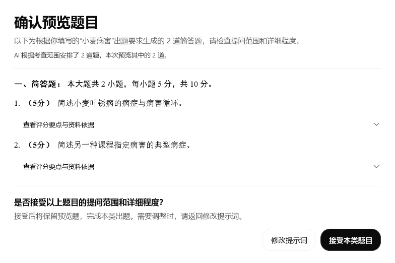
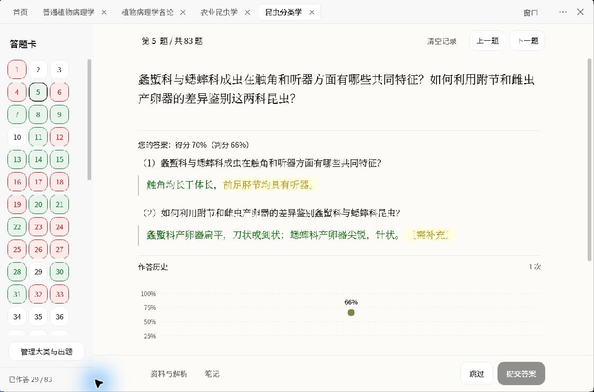
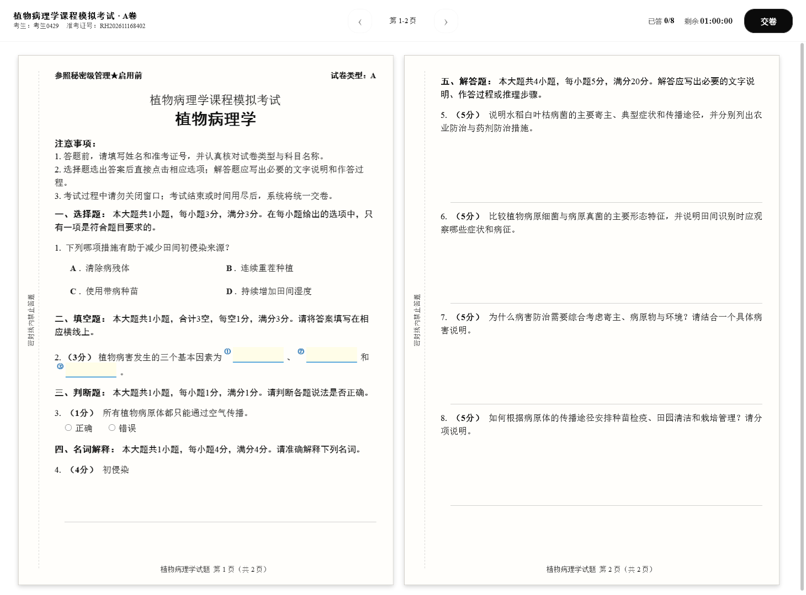
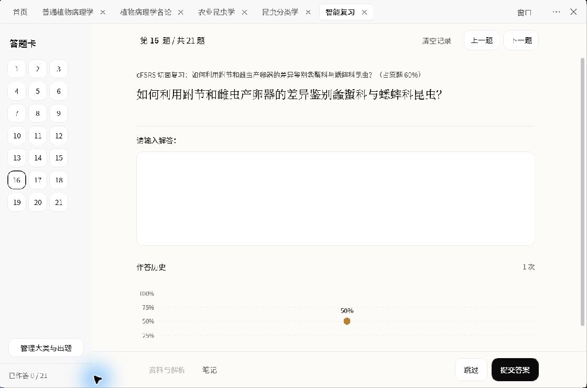

# ReciteHelper

**简体中文** · [English](README_EN.md)

[](https://github.com/ArabidopsisDev/ReciteHelper/actions/workflows/dotnet.yml) [](LICENSE)

ReciteHelper 是一款开源的 Windows 课程学习与考试复习软件。你可以把教材、讲义或笔记整理成知识点和题库，也可以导入已有试卷进行限时练习。交卷或提交答案后，可以查看批改结果、核对课程资料。程序根据平时的作答记录安排下一次复习。

**[下载 Windows 版](https://github.com/ArabidopsisDev/ReciteHelper/releases/latest)** · [6.0 Balsamine 更新说明](https://github.com/ArabidopsisDev/ReciteHelper/releases/tag/v6) · [用户手册](docs/manual-cn.md) · [问题反馈](https://github.com/ArabidopsisDev/ReciteHelper/issues)

[快速开始](#快速开始) · [主要功能](#主要功能) · [界面预览](#界面预览) · [模型服务](#模型服务) · [文档](#文档) · [从源码构建](#从源码构建)

## 快速开始

1. 从发布页下载 **Windows x64 ZIP**。压缩包包含 .NET 10 桌面运行时，完整解压后运行 `ReciteHelper.Wpf.exe`。
2. 首次启动时配置一种[模型服务](#模型服务)。出题和简答题批改使用所选的文本模型。
3. 在首页点击「创建项目」，按手头的资料选择项目类型。

| 项目类型 | 适合怎样开始 |
| --- | --- |
| **经典复习项目** | 已有教材或讲义，希望按章节整理知识点和题库。可以直接导入文字型 PDF，或用「文件合并」把 Word、PowerPoint、PDF 和 TXT 整理成 `.meg` 后导入。扫描件需要先转成可读取的文字。 |
| **规则化复习项目** | 已列好考查范围，希望练习指定主题的简答题。按大类填写要求，可以附上讲义或粘贴笔记。程序先给出预览题，接受预览后再完成本类出题。 |

创建完成后，在「章节与聚类」中选择一章开始答题。已有试卷时，可在项目页通过「导入与导出」导入套卷，再进入「模拟考试」选择它。导入步骤见[用户手册](docs/manual-cn.md)。

## 主要功能

- **知识点与章节练习。** 按章节阅读知识点并记录掌握进度。练习和考试涵盖选择、填空、判断、名词解释和解答题。简答题可以逐问作答，批改结果直接标在原答案上。
- **组卷与模拟考试。** 从项目题库按章节权重抽题，设置题量和考试时长。也可以从 PDF、TXT、HTML 或 MHTML 导入一套或多套试卷。交卷后逐题回顾答案、得分与解析，并导出考试报告。
- **资料检索与错题订正。** 经典项目可以建立本地文件型向量知识库。在「资料与解析」中查看相关原文，按需生成讲解。「错题列表」汇集需要改正和补充的内容，可导出为 Word 文档。
- **智能复习。** FSRS-6 根据作答记录估计回忆率，安排到期的题目或小问。规则化项目中的多问简答题可以按小问记录记忆状态，方便单独补练未掌握的部分。项目积累足够记录后，程序可拟合个人复习参数。[调度规则与实验](docs/facet-review.md)
- **项目笔记与工作区。** 在标签页之间切换项目、章节练习和模型设置。笔记随项目保存。资料、笔记和错题面板可以停靠或浮动，布局会保存供下次打开时使用。

## 界面预览

<table>
  <tr>
    <td width="50%" valign="top">
      <strong>出题预览</strong><br />
      接受预览题前，可以展开核对评分要点和资料依据。<br />
      <a href="docs/design/screenshots/cfsrs-preview.png"></a>
    </td>
    <td width="50%" valign="top">
      <strong>章节练习与分问批改</strong><br />
      农业昆虫学的作答记录中，第二问标出了需要补充的内容。<br />
      <a href="docs/Resources/readme/01-subquestion-grading.jpg"></a>
    </td>
  </tr>
  <tr>
    <td width="50%" valign="top">
      <strong>限时模拟考试</strong><br />
      在试卷内填写各类题目，答题进度和剩余时间显示在顶部。<br />
      <a href="docs/design/screenshots/exam-current.png"></a>
    </td>
    <td width="50%" valign="top">
      <strong>智能复习</strong><br />
      对应上图的第二问到期后，被单独安排在复习题单中。<br />
      <a href="docs/Resources/readme/02-focused-review.jpg"></a>
    </td>
  </tr>
</table>

## 模型服务

首次启动时配置模型。以后可在首页的「模型服务设置」切换文本服务。建立经典项目的向量知识库时，还需有可用的向量服务。

| 接入方式 | 需要准备 | 用途 |
| --- | --- | --- |
| **DeepSeek + Qwen** | DeepSeek API Key，按需配置 Qwen API Key | DeepSeek 用于文本生成，Qwen 用于向量化和知识库语义检索。 |
| **OpenRouter** | 一个 OpenRouter API Key | 在同一服务中选择文本模型和向量模型。 |
| **托管服务** | ReciteHelper 激活码 | 由托管服务提供文本和向量能力。 |
| **模型账号 OAuth** | 服务账号及对应模型权限 | 通过浏览器或设备码授权文本模型，也可另外配置 Qwen、OpenRouter 或托管向量服务。 |

OAuth 支持 Anthropic、OpenAI、OpenAI Codex、GitHub Copilot、Kimi Code、Meta、OpenRouter、Radius 和 xAI。程序按各服务的协议完成授权和刷新，凭据通过 Windows DPAPI 加密后保存在当前用户的本地应用数据中。[OAuth 接入指南](docs/pi-oauth.md)

手动配置的 API Key 可保存在本机 `Config.xml`，也可通过 `DEEPSEEK_API_KEY`、`QWEN_API_KEY` 和 `OPENROUTER_API_KEY` 环境变量提供。出题、AI 批改、向量化和解析会把相应的资料片段、题目或答案发送给所配置的服务。

## 项目文件与分享

章节、题库、作答记录和项目笔记保存在本地 `.rhproj` 文件中。知识库与导入的套卷保存在项目目录。迁移项目时请保留整个目录，以便重新打开时能够读取这些配套文件。

项目页的「导入与导出」可以把项目及配套文件打包为 `.rhp`。打包内容包括已保存的作答记录和笔记。接收者可以在首页点击「导入共享项目」打开这个包。

## 文档

| 文档 | 内容 |
| --- | --- |
| [中文用户手册](docs/manual-cn.md) · [English user manual](docs/manual-en.md) | 安装、资料准备、知识点学习、练习与考试 |
| [规则化复习项目](docs/rule-review.md) | 设置出题范围、预览题目、追加题目和查看批改 |
| [cFSRS 调度说明](docs/facet-review.md) | 小问记忆状态、复习顺序和实验记录 |
| [OAuth 接入指南](docs/pi-oauth.md) | 支持的账号、授权步骤、凭据保存与向量配置 |

## 从源码构建

在 Windows 上安装 [.NET 10 SDK](https://dotnet.microsoft.com/download/dotnet/10.0)，然后在 PowerShell 中运行以下命令。也可在支持 WPF 的 Visual Studio 或 JetBrains Rider 中打开解决方案 `src/ReciteHelper.slnx`。

```powershell
git clone https://github.com/ArabidopsisDev/ReciteHelper.git
cd ReciteHelper
dotnet restore src/ReciteHelper.slnx
dotnet build src/ReciteHelper.slnx --configuration Release --no-restore
dotnet test src/ReciteHelper.slnx --configuration Release --no-build
dotnet run --project ReciteHelper.Wpf/ReciteHelper.Wpf.csproj --configuration Release --no-build
```

OAuth 使用原生 C# 实现，构建和运行所需的工具链为 .NET。pi 协议和模型目录的 MIT 许可证随应用分发。[第三方许可证](ReciteHelper.Infrastructure/OAuth/PI-LICENSE.txt)

## 反馈与贡献

- 通过 [GitHub Issues](https://github.com/ArabidopsisDev/ReciteHelper/issues) 反馈问题或提出建议。报告界面问题时可以附上版本、复现步骤和截图。
- 也可以发邮件至 [arab@methodbox.top](mailto:arab@methodbox.top)，或加入 QQ 讨论群 `1053379975`。
- 提交代码、测试或翻译时，先 Fork 仓库，再从 `primary` 创建分支。提交前运行 Release 构建和测试，在 Pull Request 中说明变更，附上相关 Issue 或界面截图。参与前请阅读[行为准则](CODE_OF_CONDUCT.md)。

## 许可证与致谢

ReciteHelper 以 [GNU AGPL v3.0 或更新版本](LICENSE)发布。分发衍生作品或基于本项目提供网络服务时，请遵守许可证中的源码要求。

感谢 Sati、Mrwhite3142、oife、AcE77505，以及所有改进文件处理、兼容性和稳定性的贡献者。

<p>
  
  &nbsp;
  
</p>

[Star 趋势](https://star-history.com/#ArabidopsisDev/ReciteHelper&Date)
