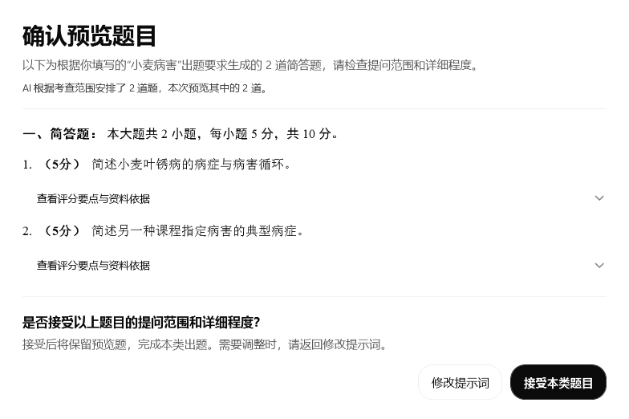
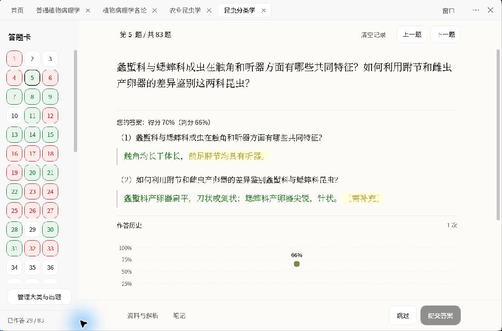
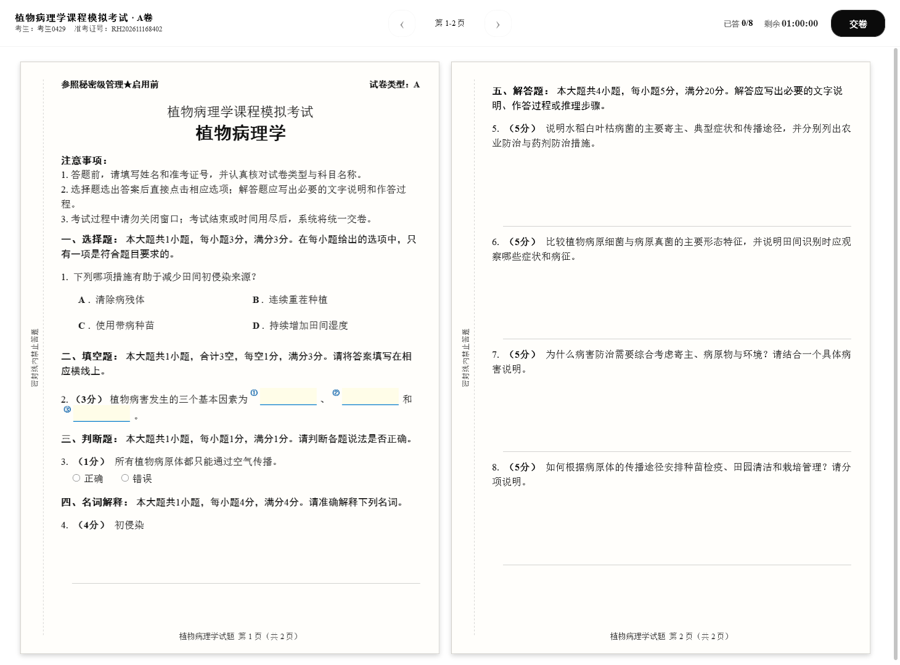
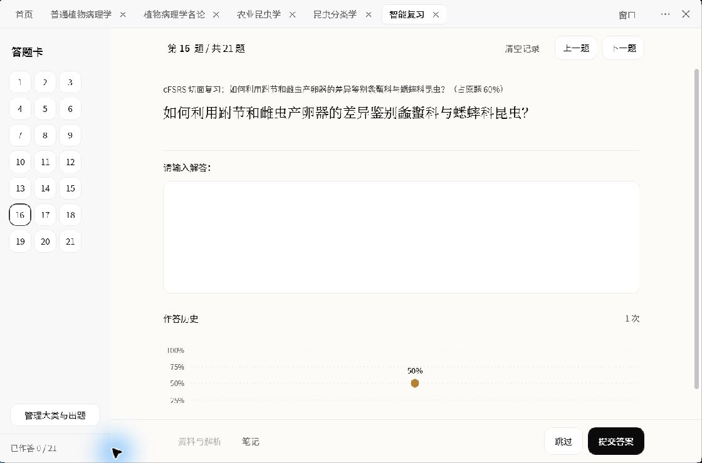

# ReciteHelper

[简体中文](README.md) · **English**

[](https://github.com/ArabidopsisDev/ReciteHelper/actions/workflows/dotnet.yml) [](LICENSE)

ReciteHelper is an open-source Windows app for studying course material and preparing for exams. Turn textbooks and lecture notes into a question bank and chapter study material, or import an existing paper for timed practice. After answering, you can read the feedback and check it against your course material. ReciteHelper uses your practice history to schedule what to review next.

**[Download for Windows](https://github.com/ArabidopsisDev/ReciteHelper/releases/latest)** · [6.0 Balsamine release notes](https://github.com/ArabidopsisDev/ReciteHelper/releases/tag/v6) · [User manual](docs/manual-en.md) · [Report an issue](https://github.com/ArabidopsisDev/ReciteHelper/issues)

[Quick start](#quick-start) · [Features](#features) · [Screenshots](#screenshots) · [Model services](#model-services) · [Documentation](#documentation) · [Build from source](#build-from-source)

## Quick start

1. Download the **Windows x64 ZIP** from Releases. It includes the .NET 10 Desktop Runtime. Extract the full archive and run `ReciteHelper.Wpf.exe`.
2. Configure a [model service](#model-services) on first launch. ReciteHelper uses the selected text model to generate questions and grade short answers.
3. Select **Create Project** on the home screen and choose a project type based on the material you have.

| Project type | When to use it |
| --- | --- |
| **Classic review** | You have a textbook or lecture notes and want a chapter-based question bank and study material. Import a PDF with selectable text, or combine Word, PowerPoint, PDF, and TXT files into a `.meg` file using the file merge tool. Convert scanned pages to text first. |
| **Rule-based review** | You have a list of topics and want short-answer questions on a specific scope. Define the requirements for each category and optionally attach course materials or paste notes. Review the preview questions before generating the rest of the category. |

Once the project is ready, open a chapter to start practicing. If you already have an exam paper, use **Import and Export** on the project page to import it, then select it in **Mock Exam**. Import steps are in the [user manual](docs/manual-en.md).

## Features

- **Chapter practice and study material.** Read the key points for each chapter and record which ones you have learned. Practice and exams cover multiple-choice, fill-in-the-blank, true/false, term-definition, and written questions. For a multipart written question, answer each part separately and read the feedback alongside your original response.
- **Exam generation and timed practice.** Set the time limit, question count, and chapter weights to generate a paper from your question bank. Import one or more existing papers from PDF, TXT, HTML, or MHTML. After submitting, review answers, scores, and explanations question by question and export the exam report.
- **Source lookup and corrections.** Classic projects can build a local, file-based vector index. Open **Sources and Explanations** to find relevant passages and request an explanation. The mistake list collects material to correct or add, and you can export it to Word.
- **Smart Review.** FSRS-6 uses your practice history to estimate recall and schedule due material. In rule-based projects, parts of a written question can have their own memory records so you can revisit the parts you missed. Once a project has enough review history, ReciteHelper can fit personalized scheduling parameters. [Scheduling and experiments (Chinese)](docs/facet-review.md)
- **Project notes and workspace.** Switch between projects, practice, and model settings in tabs. Notes are saved with the project. Panels for sources, notes, and mistakes can dock or float, and their layout is saved for next time.

## Screenshots

<table>
  <tr>
    <td width="50%" valign="top">
      <strong>Question preview</strong><br />
      Check the scoring criteria and source passages before accepting the preview.<br />
      <a href="docs/design/screenshots/cfsrs-preview.png"></a>
    </td>
    <td width="50%" valign="top">
      <strong>Chapter practice and grading</strong><br />
      This saved answer from an agricultural entomology course shows what the learner missed in the second part.<br />
      <a href="docs/Resources/readme/01-subquestion-grading.jpg"></a>
    </td>
  </tr>
  <tr>
    <td width="50%" valign="top">
      <strong>Timed mock exam</strong><br />
      Answer on the exam paper and check your progress and remaining time at the top.<br />
      <a href="docs/design/screenshots/exam-current.png"></a>
    </td>
    <td width="50%" valign="top">
      <strong>Smart Review</strong><br />
      When the second part of the question above is due, it appears on its own in the review session.<br />
      <a href="docs/Resources/readme/02-focused-review.jpg"></a>
    </td>
  </tr>
</table>

## Model services

Configure a model on first launch. You can change the text service later in **Model Service Settings** on the home screen. Building a vector index for a classic project also requires an embedding service.

| Service | What you need | How ReciteHelper uses it |
| --- | --- | --- |
| **DeepSeek + Qwen** | A DeepSeek API key, plus a Qwen key for embeddings | DeepSeek generates text. Qwen creates embeddings and supports semantic search. |
| **OpenRouter** | One OpenRouter API key | Choose text and embedding models from the same service. |
| **Hosted service** | A ReciteHelper activation code | The hosted service provides text generation and embeddings. |
| **Model account OAuth** | An account with model access | Authorize a text model in the browser or with a device code. Embeddings can use Qwen, OpenRouter, or the hosted service. |

OAuth supports Anthropic, OpenAI, OpenAI Codex, GitHub Copilot, Kimi Code, Meta, OpenRouter, Radius, and xAI. Authorization and refresh follow each provider’s protocol. ReciteHelper encrypts the credentials with Windows DPAPI and saves them in the current user’s local app data. [OAuth setup](docs/pi-oauth.md)

API keys can be stored in the local `Config.xml` or supplied through `DEEPSEEK_API_KEY`, `QWEN_API_KEY`, and `OPENROUTER_API_KEY`. Question generation, AI grading, embedding, and explanation requests send the relevant passages, questions, or answers to the configured service.

## Project files and sharing

Chapters, questions, practice history, and notes are saved in the local `.rhproj` file. Knowledge base files and imported papers are stored in the project folder. Keep the whole folder when moving a project so the app can still find those files.

Use **Import and Export** on the project page to package the project and its files as an `.rhp` archive. The package includes saved practice records and notes. The recipient can open it with **Import Shared Project** on the home screen.

## Documentation

| Guide | What it covers |
| --- | --- |
| [English user manual](docs/manual-en.md) · [中文用户手册](docs/manual-cn.md) | Setup, preparing material, study, practice, and exams |
| [Rule-based review (Chinese)](docs/rule-review.md) | Defining topics, previewing questions, adding to a project, and grading |
| [cFSRS scheduling (Chinese)](docs/facet-review.md) | Memory records for subquestions, scheduling, and experiments |
| [OAuth setup (Chinese)](docs/pi-oauth.md) | Supported accounts, authorization, credentials, and embeddings |

## Build from source

Install the [.NET 10 SDK](https://dotnet.microsoft.com/download/dotnet/10.0) on Windows and run the following commands in PowerShell. You can also open `src/ReciteHelper.slnx` in an edition of Visual Studio or JetBrains Rider that supports WPF.

```powershell
git clone https://github.com/ArabidopsisDev/ReciteHelper.git
cd ReciteHelper
dotnet restore src/ReciteHelper.slnx
dotnet build src/ReciteHelper.slnx --configuration Release --no-restore
dotnet test src/ReciteHelper.slnx --configuration Release --no-build
dotnet run --project ReciteHelper.Wpf/ReciteHelper.Wpf.csproj --configuration Release --no-build
```

OAuth is implemented in C# and uses the .NET toolchain for build and runtime. The MIT license for the pi protocol and model catalog is distributed with the app. [Third-party license](ReciteHelper.Infrastructure/OAuth/PI-LICENSE.txt)

## Feedback and contributions

- Use [GitHub Issues](https://github.com/ArabidopsisDev/ReciteHelper/issues) for bugs and proposals. For an interface issue, include the version, steps to reproduce it, and a screenshot where helpful.
- You can also email [arab@methodbox.top](mailto:arab@methodbox.top) or join QQ group `1053379975`.
- For code, tests, or translations, fork the repository and branch from `primary`. Run the Release build and tests, then describe the change in your pull request and link the relevant issue or attach screenshots. Read the [Code of Conduct](CODE_OF_CONDUCT.md) before contributing.

## License and acknowledgements

ReciteHelper is licensed under the [GNU AGPL v3.0 or later](LICENSE). If you distribute a derivative work or provide a network service based on this project, follow the license’s source code requirements.

Thanks to Sati, Mrwhite3142, oife, AcE77505, and everyone who helped improve file handling, compatibility, and stability.

<p>
  
  &nbsp;
  
</p>

[Star history](https://star-history.com/#ArabidopsisDev/ReciteHelper&Date)
