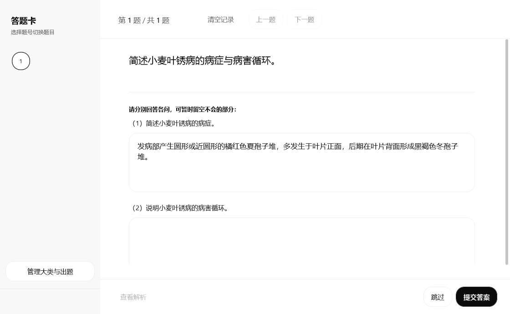
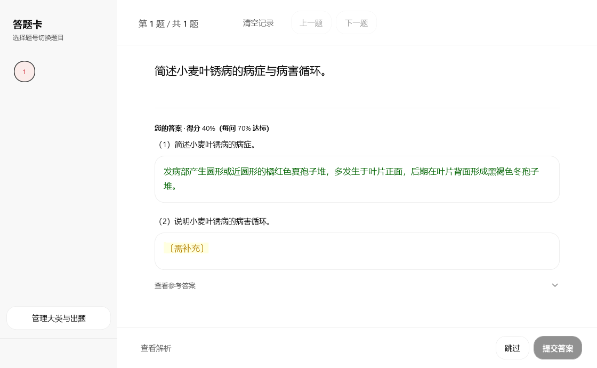

# cFSRS 判分、出题与调度实验

日期：2026-11-16。代码与实验均在 D 盘完成。实验数据不包含模型密钥或个人学习记录。

本次解决的问题是：简答题将补充知识当作必答内容、只有完全覆盖参考答案才通过，多问共用一个输入框，以及长资料和串行生成造成等待。cFSRS 继续使用 FSRS-6 的单项记忆模型，调整评分证据、组件粒度和候选安排。算法依据和公式见 [cFSRS 说明](../facet-review.md)。

## 真实模型批改

通过环境变量中的 DeepSeek 密钥调用 `deepseek-chat`，使用实际 `AiAnswerGrader` 的提示词、资料上下文、批注恢复和评分处理。实验温度为 0。课程资料采用用户给出的小麦叶锈病病症描述；另用“栈后进先出、队列先进先出”检查漏答分问。

参考答案故意附有“可进一步补充尺寸和破裂方式”，用来检查模型是否将可选细节误作必答内容。预期通过与否在调用前设定。

| 样本 | 原始核心覆盖 | 最终得分 | 是否通过 | 符合预期 |
| --- | ---: | ---: | --- | --- |
| 用户给出的小麦叶锈病核心答案 | 100% | 100% | 是 | 是 |
| 同义简述 | 100% | 100% | 是 | 是 |
| 只写“叶片有橘红色的斑” | 40% | 40% | 否 | 是 |
| 颠倒颜色和出现时期 | 30% | 30% | 否 | 是 |
| 空答案 | 0% | 0% | 否 | 是 |
| 不提供资料、回答完整核心病症 | 100% | 100% | 是 | 是 |
| 两问只答第一问 | 50% | 50% | 否 | 是 |

7 个样本的通过判断均符合预期，单次耗时约 1.50 至 2.41 秒。完整回答不再因未展开可选细节而扣分；资料缺失和错误答案仍按内容判断。

原先要求模型复制被标记的原文，实测出现过将“橙红色”改成“橘红色”、漏掉换行的情况。现改为输入片段编号，模型返回编号、状态和说明，程序使用原文渲染。最终这组样本的原文批注全部恢复成功。原始结果见 [批改数据](cfsrs-grading-2026-11-16.json)。

70% 门槛另外通过必要的边界测试检查：69% 未通过，70% 给本问满分；某一问占 80% 且完整回答，另一问占 20% 但空白，整题得 80%，仍未全部掌握。每问独立判定，原始比例继续保存。

## 实际出题调用

使用程序的 `AiChatService`、DeepSeek 选项和 `RuleReviewService`，导入四段数据结构课程笔记，要求复习栈、队列、数组和单链表。最终安排 4 道题，涉及基本特点和主要操作两个自然分问，题目保存可在资料中核对的连续摘录。模型将前两题的分问合并在一项元数据中，界面依据明确的多问表述识别为两个输入框；旧题也使用这一识别方式。

| 场景 | 预览耗时 | 全部完成 | 结果 |
| --- | ---: | ---: | --- |
| 四种数据结构，各一题、每题两问 | 3.173 秒 | 5.918 秒 | 4 道题，8 个答题框 |
| 仅小麦叶锈病的典型病症 | 2.417 秒 | 2.419 秒 | 1 道自然题，未拆成颜色、形状等细节题 |

预览时间包含完整计划和前两道题；全程时间还包含其余题目的生成和验证，不包含用户阅读、确认的停留时间。窄范围只有一道题时，接受后直接保留，无需再调用模型。数据见 [四题出题结果](cfsrs-generation-2026-11-16.json)和 [单题结果](cfsrs-single-2026-11-16.json)。

这两个小样本不代表大型课程题库的平均耗时。等待还取决于资料量、题数、所选模型和网络。

模型输入现直接保留中文，避免 JSON 将每个汉字写为 `\uXXXX` 字符串；长资料先按范围选择相关段落，再由 AI 提取本题的原文依据，单次送入的资料控制在约 24,000 字符以内。这些改动用于控制上下文和输出长度，实验未单独测量它们各自的提速比例。

## 固定延迟与组件出场次序

使用固定每次 200 毫秒的模型替身，为已接受预览生成其余 36 道题，分成 6 批。相同批次串行等待约 1.204 秒，最多两批并行的实际服务耗时约 0.672 秒，减少约 44% 等待。此实验只比较相同批次的并发效果；旧实现每批 8 道，新实现每批 6 道，不能将该百分比直接作为真实模型整体提速比例。

另构造四道原题，每题有两块未掌握内容和一块已掌握内容。仅按占比缺口排序时，前四个候选来自两道原题；穿插同源组件后，前四个候选来自四道原题。排序仍先考虑薄弱内容和缺口，在每轮安排每道原题的一个候选。结果见 [离线实验数据](cfsrs-offline-2026-11-16.json)。

新增到期规则也经过测试：失败后 9 分钟不进入智能复习，10 分钟进入；已通过且回忆率尚未下降的内容不会为了补足题量而立即重出。单一自然题与已拆分切面都遵守这个等待规则。原题建立切面后继续排除在智能复习池之外，各聚类共同参与。

对实际生成的栈题又运行了一次完整流程：识别为两问，只回答“后进先出”，实际模型评分为 50%；建立两个组件，其中一个需要重练。刚批改后智能复习没有可抽内容，11 分钟后仅抽出遗漏的操作位置题。记录见 [生成题作答与 cFSRS 调度](cfsrs-generated-answer-2026-11-16.json)。

## 界面与自动验证

131 项测试通过，包括原有功能及本次新增的 7 项必要案例。原生 WPF 检查了资料恢复、独立输入框、留空部分的保存、每框原文批注、模拟考试布局和单题/两题预览高度。下面的界面使用离线评分示例，评分依据见上面的真实模型实验。





## 复现

离线实验默认不调用模型：

```powershell
$env:TEMP = 'D:\Temp\ReciteHelperTask'
$env:TMP = $env:TEMP
dotnet run --project experiments/cfsrs/CfsrsExperiment.csproj
```

配置 `DEEPSEEK_API_KEY` 后，可分别运行真实批改和实际服务路径的出题实验：

```powershell
dotnet run --project experiments/cfsrs/CfsrsExperiment.csproj -- --live
dotnet run --project experiments/cfsrs/CfsrsExperiment.csproj -- --generate --production
dotnet run --project experiments/cfsrs/CfsrsExperiment.csproj -- --generate --production --single
dotnet run --project experiments/cfsrs/CfsrsExperiment.csproj -- --live --generated-answer
```

输出写入 `D:\Temp\ReciteHelperTask`。本次实验验证了实现、少量课程答案和出题流程；cFSRS 的长期保持率、复习负担及参数校准还没有真实学习者的对照结果，不能据此宣称长期记忆收益。
