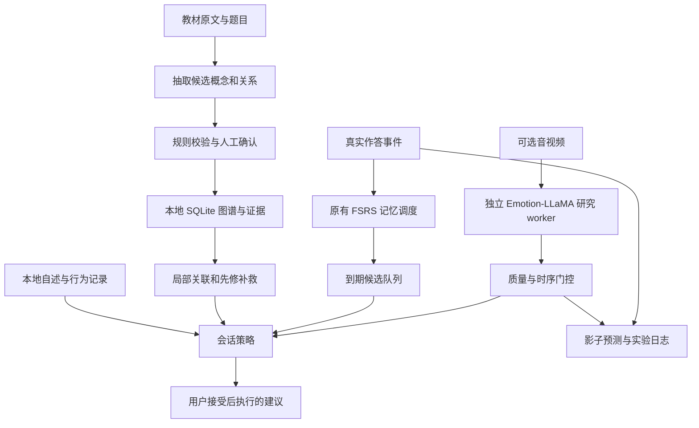

# 知识图谱接入与 Emotion-LLaMA × FSRS：确定方案

研究日期：2026-10-13。项目：OpenRecite。基线提交：`71d6f3bf82c1cf656a7003a1b708411f1245081e`。
场景由用户确认：个人电脑本地复习。本文是实施设计，不是功能完成声明。

## 1. 本次确定的路线

**把系统拆成“知识关系、记忆调度、情境观测、会话决策”四层。知识图谱告诉系统复习内容之间有什么关系；FSRS 估计一道题何时需要再复习；Emotion-LLaMA 提供带不确定性的观察；策略层决定是否提出补救、换一种讲解或休息建议。**

| 项目 | 确定采用 | 首期不采用的路线及原因 |
|---|---|---|
| 知识图谱存储 | 本地 SQLite 关系表表达属性图，独立适配器 | 不要求用户部署 Neo4j/图数据库服务器；本场景以局部一至两跳查询为主 |
| 知识图谱用途 | 逐题概念映射、原文证据、关联检索、先修补救、覆盖展示 | 不把知识图谱邻接关系等同于已经掌握，不通过传播直接写 FSRS Memory |
| 检索 | 中文关键词/向量候选 + 受控局部图扩展 + 原文引用 | 不默认执行全图社区摘要，个人教材通常先需要准确的局部说明 |
| FSRS | 保留当前 FSRS-6 为冻结基线 | 本轮不同时升级 FSRS；否则不能区分模型升级和多模态融合的收益 |
| 情绪推理 | 外部可禁用 worker；先离线复现与域内验证 | 不在跨平台 NuGet 内嵌 Python、CUDA、摄像头和大模型权重 |
| 首期融合 | 情境与行为共同支持的低风险建议，用户可接受/忽略 | 不把开心映射成 Easy、沮丧映射成 Again，不按标签直接缩短/延长间隔 |
| 后续模型研究 | 先影子回忆预测，再受限稳定度残差 | 不直接端到端替换 FSRS，不以模拟数据证明真实记忆收益 |
| 数据保存 | 图谱可分享；个人观测与媒体独立私有目录 | 不把媒体放进会自动打包分享的 `.rhproj` 项目目录 |

这里的“确定”指可以按接口和阶段实施的技术路线；“情绪有助于长期记忆预测”仍是待检验假设。

## 2. 现有实现支持什么

详见 [代码核查](local-code-audit.md)。决定方案的几个事实是：

1. `KnowledgePoint` 只有名称、正文与手工掌握标记；`Chapter` 中题目和知识点是两份列表。不存在图谱、逐题概念链接或跨版本唯一概念 ID。
2. `FileVectorStore` 是 JSON 向量列表和余弦相似度检索；它可以成为检索的一路，但不能承担概念关系存储。
3. `QuizService` 以正确性生成 Again/Good，追加历史；`FsrsReviewScheduler.Record` 单独调用只更新记忆，不追加历史。未来所有融合必须走统一事件提交入口，避免重复更新或遗漏日志。
4. 当前响应秒数在异步判题结束后计算，会包括模型判题耗时。研究用反应时必须另记“题目展示至用户提交”。
5. FSRS 优化器目前只读取时间与评分序列，没有多模态特征；已有个性化使用训练目标改善，不能代替时间外验证。
6. `ProjectFileService` 导出复制项目目录；图谱数据库导出需要一致性快照，原始音视频必须另存。其现有临时目录也依赖系统默认值，未来若要求运行产物都在 D 盘，必须新增可配置工作目录。

本轮只读取了这些生产文件。新方案、事件定义和下文接口均未写入 SDK。

## 3. 总体架构与接口边界

拟定组件职责（名称是设计合同，不是已存在的 API）：

| 组件 | 输入 → 输出 | 边界 |
|---|---|---|
| KnowledgeGraph | 题目 ID/概念 ID/查询 → 子图、证据、版本 | 不访问摄像头，不写题目 Memory |
| KnowledgeGraph.Sqlite | 图对象与快照 → 本地数据库 | 存储实现与算法核心分离 |
| StudyContext | 窗口化观测 → 可用性、质量、模型结果 | 没有合格输入时输出 unavailable，而非 neutral |
| Emotion worker | 明确支持的模态输入 → 识别结果与流水线版本 | Python/GPU 生命周期由宿主管理，SDK 不自动下载模型 |
| SessionPolicy | FSRS 队列 + 已确认图谱 + 可用情境 → 建议及理由 | 不伪造答题评分；首期不改变下一次间隔 |
| ExperimentLog | 尝试、策略、观测与曝光 → 可重放日志 | 私有、追加写、版本化，不默认导出 |

接口只传递 JSON/结构化数据，不传递数据库句柄或 Python 对象。Emotion worker 离线时，复习、图谱和保存仍能运行。

## 4. 知识图谱：具体接入方式

### 4.1 数据模型

每个概念分配持久 `ConceptId`，每道题有 `QuestionId`，每份教材有 `DocumentId` 与版本/内容哈希。不能把概念名称当主键，也不能把题目全文哈希作为唯一、永久的身份。文字修订产生内容版本，不必产生新的题目身份。旧数字 ID 不唯一、移动并改写或重名导致匹配不唯一时，一律标为 unresolved；不自动连接学习历史、不启用该题图谱策略，等人工确认。内容哈希只检测变更，不承担身份判定。

首期表：

| 表 | 关键字段 |
|---|---|
| Concept | concept_id、canonical_name、definition、status、created_version |
| ConceptAlias | concept_id、alias、language、scope |
| Relation | relation_id、source_id、type、target_id、status、reviewer、extractor_version |
| RelationEvidence | relation_id、evidence_id，多对多来源支持 |
| Evidence | document_id、document_version、page/section、span、content_hash、引用文本 |
| QuestionConcept | question_id、question_version、concept_id、primary/supporting、weight、status |
| GraphVersion | graph_version、source_hashes、schema_version、build_version、审核记录 |
| LegacyIdentityMap | 项目 ID、旧章节/题目位置与数字 ID、持久 UUID、原内容哈希 |

概念关系先限制为 `prerequisite_of`（基础概念指向后续概念）、`broader`（具体概念指向更宽泛概念）、`related` 和 `contrasts_with`。证据支持独立放在 RelationEvidence，不混成概念边；组成关系与上下位关系也不默认等同。`related` 不能自动升格为先修。先修子图需要无环；其他关系不一概要求无环。别名合并与互相比较要保留上下文，避免同词异义。

SQLite 能用递归 CTE 表达局部图遍历；Microsoft.Data.Sqlite 提供 .NET 适配。这是选择本地 SQLite 的技术基础，吞吐能力仍需用用户实际图规模验证。[SQLite 官方说明](https://sqlite.org/lang_with.html)、[Microsoft.Data.Sqlite](https://learn.microsoft.com/en-us/dotnet/standard/data/sqlite/)。

### 4.2 建图流程

1. 先从章节、现有 KnowledgePoint、题目标准答案与教材原文导入候选。
2. 提取概念别名、题目映射、关系和原文位置。抽取提示只允许声明支持证据；“看起来相关”不构成先修证据。
3. 自动检查引用存在、端点存在、方向、重复、类型、概念作用域和先修环。
4. 所有进入检索扩展或会话排序的关系与 QuestionConcept 映射必须经审核进入 accepted 状态；首版以人工确认实现该门槛。未审核内容只能显示为候选。模型生成的置信度仅作分流线索，不能凭自报高分绕过审核。
5. 发布不可变图快照。失败时保留上一版；任何边都能追溯到输入版本与审核决定。

来源追踪借鉴 W3C PROV 的派生关系，但首期不要求整个系统采用 RDF。若将来导出 RDF，再以 SHACL 对同一模式做约束验证。[PROV-O](https://www.w3.org/TR/prov-o/)、[SHACL](https://www.w3.org/TR/shacl/)。

### 4.3 复习中的行为

- **解释错题**：题目 → 已审核核心概念 → 一跳先修/比较概念 → 相应原文证据。所有说明附原文位置。
- **提供补救**：学习者连续受阻且接受帮助后，展示最多一至两个先修概念及例题；这属于辅助学习事件，不自动给原题记 Good。
- **展示覆盖**：计算已映射题目的覆盖与“现有题目回忆证据”，显示样本不足。不能把邻接概念的预测回忆均值称为已验证的概念掌握概率。
- **调整候选**：第一阶段只提供解释和建议。开启排序实验后，先锁定 FSRS 到期候选，只在相近回忆概率的同一候选段内减少重复、增加概念覆盖，保留最急迫项目。

初始实验约束：先冻结基础生成器选定的 N 题，只在同优先级、同回忆概率桶中重排（桶宽 0.05，bucket=floor(clamp(R,0,1)/0.05)）。辅助练习单列，预算不超过会话总时间的 10%，单次最多 2 个；这些是预注册待调的工程约束，不是教育学定律。记录被延后的题目与延后次数；本会话的到期题集合不因情绪自动删除。

检索采用关键词/向量候选与局部图扩展，最后回到原文证据。Microsoft GraphRAG 的 local search 本身也把图结构和原始文本结合；本项目只借鉴局部检索思路，不要求整套全局社区摘要流程。[GraphRAG local search](https://microsoft.github.io/graphrag/query/local_search/)。

## 5. Emotion-LLaMA：可复现与可部署边界

### 5.1 锁定对象

本方案锁定 **Emotion-LLaMA v1（NeurIPS 2024）**作为复现对象；首先验证已公开的 demo 路线，完整特征复现另列实验，仓库提交：
`6f8d05087b2a91e445ad986545977fda7eb1b6a4`。作者已有后续 v2 路线，不将 v1 描述为最新模型；版本升级应是独立实验变量。

官方论文与仓库：[论文](https://arxiv.org/abs/2406.11161)、[固定源码](https://github.com/ZebangCheng/Emotion-LLaMA/tree/6f8d05087b2a91e445ad986545977fda7eb1b6a4)。

最重要的复现区别：论文架构用多组视觉与音频表征；当前 demo 路径读取视频首帧和音频，并把两组视觉特征置零。因此必须分别记录 `paper-full-features` 与 `demo-firstframe-audio`，不能借用论文得分替代 demo 或桌面场景的实测。实现细节与证据见 [专项报告](emotion-llama-research.md) 和 [conversation.py 快照](evidence/emotion-llama/minigpt4__conversation__conversation.py)。

### 5.2 针对本机的部署决定

本机只读枚举为 Iris Xe、15.73 GiB RAM，未发现 nvidia-smi；官方推理路径使用 CUDA。**当前电脑先运行图谱、FSRS、行为记录与用户自述基线，不承诺直接跑通官方多模态推理。**

需要 Emotion-LLaMA 数据时，在具备可用 GPU 的独立研究环境做离线批量推理；可在用户未来配备的本地 GPU 上运行。局域网实验机器只在用户主动选择且允许传输相关片段时启用，不作为默认联网服务。当前不安装驱动、不创建云实例、不上传音视频。

第一步是分别测量预处理、模型加载、单窗口推理的 p50/p95 时延、峰值显存、稳定性；官方训练显存要求不能当作本地推理门槛。量化 CPU 版本、ONNX 导出、缺失模态推理都不能在未经验证时写成现成能力。

### 5.3 观测协议

- 捕获由用户主动开启。静默阅读无音频不算异常；无音频不填“中性”或静音向量冒充完整模态。
- 候选实验窗口为提交前最后 8 秒，最短有效窗口和采样率按模型实际预处理固定；8 秒是本项目实验起点，需验证。首期有效观测的新鲜度上限暂定为 60 秒，至少两个间隔短窗提供一致证据后才考虑主动建议，建议间隔至少 10 分钟、每会话最多 2 次；均需可用性试验调整。
- 分开记录展示、用户提交、反馈展示、采样结束与推理结果可用时间。结果只可影响它到达后的决策。
- 保留 `modalityMask`、pipeline/checkpoint/processor 版本、窗口相位、可用性、质量、校准版本与异常原因。没做校准时 `calibratedConfidence=null`。
- 自然语言输出不是概率。不要从“我很确定”提取置信度；使用明确类别评分/验证集校准，或者保持 shadow-only。
- 中文文本/语音、安静面部、学习活动、遮挡、眼镜与设备差异分别验证。英文示例或演员片段的指标不能代表用户的中文自主复习。
- 候选输出包括原始情绪标签与质量信息。困惑、认知负荷、疲劳、专注是不同构念；没有对应域内标注和模型验证时，不生成这些“已测得”属性。

单凭面部动作推断情绪受到情境与个体差异影响；使用多模态也不会自动消除该问题。这支持本方案使用质量门控、自述核对与可退出设计。[相关研究](https://www.psychologicalscience.org/journals/pspi/1529100619832930/)。

### 5.4 模型与包的许可边界

OpenRecite 的 LGPL 声明不改变第三方模型和训练数据许可。官方源码许可证与 MER 数据 EULA 是不同文件；后者对数据及其派生模型有科研、非商业限制。固定版本条款见 [LICENSE_EULA.md](https://github.com/ZebangCheng/Emotion-LLaMA/blob/6f8d05087b2a91e445ad986545977fda7eb1b6a4/LICENSE_EULA.md)。

因此决定：NuGet 只提供自有接口；权重、数据、Python 模型依赖不随核心包分发。科研推理与最终可发布产品分开核对每个 checkpoint 的许可证。个人、非商业使用本身不自动等于 EULA 的 scientific 用途；日常功能启用前仍需确认适用授权，独立 worker 不能消除此条件。本研究没有授予任何第三方权重的新使用权。

## 6. 融合的三层设计

### 6.1 第一层：可进入实施的会话策略

策略输入为 FSRS 风险、经审核的概念关联、近期真实受阻事件、自述，以及可用且通过校准的情绪观测。

| 观察 | 允许的决定 | 不推断什么 |
|---|---|---|
| 反复出错 + 确认的先修缺口 | 提议短先修讲解/比较例题 | 不给先修题自动记错 |
| 用户自述疲惫/主动请求暂停 | 提议短休息或结束当前会话 | 不重写已记录的记忆状态 |
| 有效情绪观测 + 行为受阻 + 用户认可 | 提议切换讲解形式，记录接受与效果 | 不推断患病、注意力缺陷或认知能力 |
| 无信号、模态不支持、未校准、超时 | 保持原 FSRS 流程 | 不把 unavailable 当成 neutral |
| 只出现短暂困惑 | 默认继续，提供可点选帮助 | 不立即打断有效的思考 |

初始策略只提议动作，避免不断弹窗。提示频率上限与冷却期预注册为实验参数；用户忽略或关闭后不重复追问。原题真实作答标签照常记录；辅助讲解和看答案后的复述另记曝光。

### 6.2 第二层：影子预测融合

目标：检验多模态是否在已有 FSRS、图谱和行为之外提供额外预测信息。计算但不控制复习计划。

基线：

\[
R_0(t)=\left(1+F t/S\right)^{-d},\qquad F=0.9^{-1/d}-1.
\]

候选校正（B 为行为/图谱等无情绪残差，E 为情绪增量）：

\[
\hat R=\sigma\bigl(\operatorname{logit}(\operatorname{clip}(R_0,\epsilon,1-\epsilon))+f_B(b)+g_E(e)\,\operatorname{clip}(f_E(e),-c,c)\bigr).
\]

`g_E` 表示情绪输入和校准是否可用，`f_B` 是独立训练和比较的无情绪基线。输入分清两类：

- **上一有效学习时刻的特征**用于下一次延迟回忆预测，才可能反映编码和保持。
- **本次作答前的状态**可解释当下发挥，但不能直接转换为未来长期记忆强度。

这两种任务各建数据集、模型与指标。不能用当前已说出的答案、判题结果或反馈后表情预测同一次正确性。即使转录发生在提交前，口头答案也可能直接泄露正确性；若保留它，必须另标为“作答内容预测”，不能归因为情绪增益。若缺少多模态输入，情绪残差设为 0，精确回归无情绪基线；所有扩展禁用时 `f_B=0`，回到纯 FSRS。图谱特征和行为特征各有独立消融，不能把其收益算到 Emotion-LLaMA 头上。

模型先用正则化的低维线性/小型模型；未经足够数据，不训练大规模融合 Transformer。训练损失为延迟无提示回忆的 log-loss，加正则；验证按用户和时间切分。

### 6.3 第三层：受限记忆融合，仅用于通过门槛后的实验

当历史多模态确实改善时间外记忆预测，再研究：

\[
S_{\mathrm{eff},k}=S_{\mathrm{FSRS},k}\exp(\delta_k),\quad
\delta_k=g_k\operatorname{clip}(f_\theta(x_k),-b,b).
\]

`x_k` 在上一真实学习事件完成后固定，仅使用当时可得信息；在下一次真实复习前，`delta_k` 保持不变。把有效稳定度代入同一遗忘曲线及反函数，保持随间隔单调下降。原始 FSRS 状态、研究残差和模型版本分别保存，可随时重放并切回基线。

这不是“难过就缩短 20%”。符号和系数必须来自真实域内训练；边界 `b` 是验证后的工程限制，而不是文献给出的情绪效应。首轮独立调度试验建议上界为 `b=log(1.10)`，只允许 1/1.1–1.1 倍稳定度范围，并仍需通过验证。演示脚本故意使用较宽的 ±0.2 展示敏感性：间隔约为原来的 0.819–1.221 倍，不是拟定上线参数。它没有证明这些系数有效。

当前决定是**先实施第一层，第二层做观测实验，第三层暂不进入正式调度**。即使第二层预测更准，也还需要因果干预实验才能主张提高学习效率。

## 7. 时序、日志与泄漏控制

完整字段示例：[contracts.example.json](contracts.example.json)。所有实验记录必须包含：

- Project/Question/Session/Attempt 的持久 ID。
- 事件 UTC 时间、studyTimezone、题目展示、提交、反馈、窗口结束与结果可用时间。
- FSRS 算法/参数版本、图谱版本、题目版本、特征处理器和 checkpoint 哈希。
- 是否看答案、接受提示、语音复述、辅助学习曝光，以及真正无提示的评分。
- 初始候选、实际队列、推荐理由、接受/拒绝、随机化概率和抽样种子。

例：用户 10:00:25 提交，10:00:26 看到反馈，而 Emotion 结果 10:00:29 返回。这个结果不能被回填成 10:00:26 的已知输入，更不能用其反馈后部分拟合本次标签。

个人阶段按完整会话和时间分段，留出最终未来时段；多人阶段再另设完全未见用户测试集。同一段录制、同一道题的改写/派生样本、同教材近重复题不得跨训练测试泄漏。只用截止训练时刻的图谱与用户证据生成个性化特征；静态教材关系可以提前建图，但不能混入未来作答生成的边。

## 8. 隐私与磁盘布局

本次研究全部主动保存到：
`D:\Projects\OpenRecite\research\2026-10-13-knowledge-emotion-fsrs`。

后续实现建议显式配置两个本地根目录：

- 可分享项目：`D:\OpenReciteData\Projects\...`，包含题库与图谱快照。
- 私有工作区：`D:\OpenReciteData\Private\...`，包含个人日志、模型缓存及用户授权留存的片段。

音视频默认只在内存或短期缓冲；长时间保存必须单独开启并设置保留期。个人原始音视频、embedding、情绪标签都不默认进入 `.rhp` 导出。图谱 SQLite 通过 Backup/事务快照导出，不能只复制仍有 WAL 写入的主数据库文件。

后续实验运行时统一设置临时目录与模型缓存：TEMP、TMP、TMPDIR、HF_HOME、HF_HUB_CACHE、TORCH_HOME、XDG_CACHE_HOME 等指向 D 盘；启动前检查路径。仅修改模型工作区的配置，不篡改系统全局缓存。当前没有执行这些模型部署步骤。

## 9. 实验协议与放行标准

所有以下门槛是本项目**预注册建议**，不是已获得结果；各专题中的补充阈值用于估算与设计，最终执行口径以本文件的统一协议为准。若未达门槛，维持基线，不通过挑选种子或指标改写结论。

### 9.1 图谱质量与效用

先选一个真实学科/教材小集，人工标注概念、映射、证据与关键先修关系；可从约 200 个概念、500 道题开始，按概念和题型分层抽样。记录标注时间与分歧，不只报总体准确率。

- 首要门槛：启用的关键先修边经人工确认，证据定位有效率 100%；抽查未审核候选的精确率与召回率分开报告。
- 检索对照：同一批问题，关键词、向量、关键词+向量、再加局部图；比较 Recall@5、引用支持率、错误引用和延迟。
- 效用对照：固定学习时间与题目难度，比较 7 日无提示回忆；辅助练习算进总学习时间。
- 若图只是解释更清楚但没有记忆收益，可作为解释功能保留，不宣称调度改善。

### 9.2 模态与域内校准

分开报告自述、行为、视频、音频、完整多模态及模态缺失条件。先验证固定 demo 的推理和输入一致性，再进行用户域内片段验证；若另恢复论文完整特征流程，单独做其 benchmark 复现。两种 pipeline 的指标与校准器不得互相替代。

- 报 macro-F1/每类召回、校准、abstention 后的 coverage-risk、光照/遮挡/语言分组表现。
- 对会触发提示的狭义目标定义标注与误触发成本，再选择门槛。原始标签没有经过域内校准时始终 shadow-only。
- 延迟预算以“不阻塞答题”为首要约束，结果晚到就仅作后续分析。必须实测 p50/p95，不写未经测量的实时帧率或显存保证。
- 用户自述与外部观察分别保存；二者不一致时不能事后修改“真值”使模型得分变高。

### 9.3 预测与因果效果必须分开

预测消融至少包括：

| 组 | 输入 | 用途 |
|---|---|---|
| P0 | 冻结 FSRS-6 | 最基础对照 |
| P1 | FSRS + 现有行为记录 | 判断是否只是反应时等带来的收益 |
| P2 | P1 + 图谱特征 | 判断知识关系贡献 |
| P3 | P2 + 用户自述 | 低成本情境基线 |
| P4 | P3 + Emotion-LLaMA | 检验自动多模态的增量价值 |
| P5 | P4 的移除音频/视频/文本、打乱情绪配对 | 检测模态贡献与泄漏/伪相关 |

若 P4 不优于 P3，就不把昂贵自动观测升级为必需组件。指标包括 held-out log-loss、Brier、分组校准、覆盖和推理成本。只有校准和组间差异也可接受，才进入小规模干预试验。

个人阶段采取跨多周、多会话的随机建议实验：只在满足条件且非暂停/结束状态的时刻，以预设概率分配“建议/不建议”，记录概率；日/会话为聚类单位。图谱提示和情绪提示分阶段或用清楚的因子设计，避免两者同时开关后无法归因。由于记忆存在不可消除的历史效应，不把 ABAB 当有完全洗脱的药物交叉试验。

主要学习终点为固定学习时间后的 **7 日无提示回忆**，30 日为次要保持终点；同时记录退出、总复习时间、接受率与干扰。对照不只看当场答对数。未完成延迟测试报告为缺失并做敏感性分析，不能记作错误或成功。

确认性多人试验可使用 2×2（无/有图谱 × 无/有情境建议）设计，FSRS 和时间预算保持一致。先小样估计方差和组内相关，再确定样本量与停止规则。

示例样本量计算：独立二项观察、双侧 0.05、功效 0.8，80%→85% 约需每组 906 次独立观察，80%→83% 约 2629 次。这些是独立观察数下界，**不是参与者数，更不是一次几十条自测就能验证的提升**。重复测量、流失与多重比较需要进一步调整。

## 10. 实施先后顺序与完成定义

| 阶段 | 交付 | 进入下一步的条件 |
|---|---|---|
| A：事件底座 | 稳定 ID、精确提交时间、唯一作答提交、提示曝光、版本日志 | 历史可重放，辅助学习不污染无提示回忆，产物路径均显式配置 |
| B：本地图谱 | SQLite 模式、审核入口、一跳证据查询、快照迁移 | 关键关系有证据、无先修环、旧项目仍可独立复习 |
| C：无模型建议基线 | 图谱补救、自述、行为基线 | 用户可退出，建议不越权改变记忆/评分，完成可测量性检查 |
| D：Emotion 研究复现 | 固定 pipeline/checkpoint、许可清单、域内观测与校准 | 完整模态与 demo 分开，支持的输入场景和失败模式清楚 |
| E：融合影子实验 | P0–P5、时间外预测、延迟测试 | 有稳定增量价值，缺失与子群无不可接受退化 |
| F：小规模建议实验 | 随机干预、7/30 日终点与成本分析 | 预注册条件满足，效益足以覆盖打断/成本 |
| G：记忆残差研究 | 固定版本 S_eff 与可回滚调度 | 另行验证校准、单调性、长期保持和因果收益后才考虑正式启用 |

图谱 B 不依赖 Emotion D。当前硬件无法运行 D 时，A–C 仍是完整可交付路线；D–G 可以留在独立科研环境。此顺序避免先开发一整套采集系统，最后发现自动情绪对目标任务没有增量价值。

## 11. 本轮实际完成与没有声称完成的事项

实际完成：本地源码审查、官方论文/仓库/文档核查、固定提交证据快照、数据契约草案、阶段设计，以及可复现的纯公式敏感性实验。

敏感性实验见 [脚本](experiments/sensitivity.py) 与 [结果](experiments/sensitivity-summary.json)。三组稳定度、三个假设残差、输入可用/缺失共 18 个组合，验证缺失时精确回退、遗忘曲线单调性和反函数一致性。它不含真实样本，没有加载 Emotion-LLaMA，也没有评估图谱质量或真实记忆增益。

源码和 NuGet 包未修改；没有采集音视频、安装模型、申请数据集或触发云服务。具体专题证据、原始链接和进一步实验规格见 [知识图谱](knowledge-graph-research.md)、[Emotion-LLaMA](emotion-llama-research.md)、[融合研究](fusion-research.md)。
